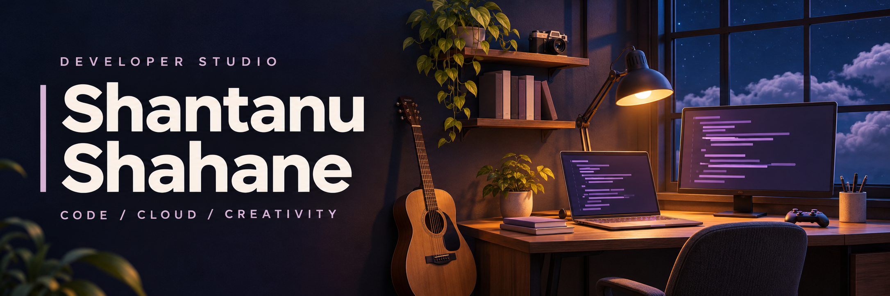
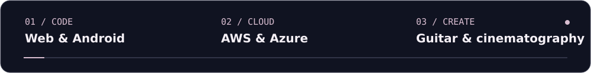

<!-- Developer Studio / Shantanu Shahane. Upload assets/ beside this README.md. -->

  

<h1 align="center">Hi, I'm Shantanu.</h1>

  <b>B.Tech · Computer Science · MIT College · India 🇮🇳</b> 
  Building for the web. Exploring the cloud.

  <a href="https://drive.google.com/drive/folders/1Vz4DSzTkxGFW-Sqx9jr0NLtFpntO1bQt"><b>View résumé</b></a> &nbsp; / &nbsp;
  <a href="https://www.linkedin.com/in/shantanu-shahane-ashtekar-4954251b8/"><b>LinkedIn</b></a> &nbsp; / &nbsp;
  <a href="mailto:shahaneshantanu2505@gmail.com"><b>Email me</b></a> &nbsp; / &nbsp;
  <a href="https://github.com/shon2505?tab=repositories"><b>Repositories</b></a>

<picture>
  <source media="(prefers-color-scheme: dark)" srcset="./studio-strip-dark.svg">
  <source media="(prefers-color-scheme: light)" srcset="./studio-strip-light.svg">
  
</picture>

---

## A little about me

I'm **Shantanu Rameshwar Shahane**, a Computer Science student at **MIT College, India**, interested in **web development, Android development, and cloud computing**.

I've worked on projects including a **Face Recognition Attendance System** and **Aegis Healthcare**, drawing on my experience with Advanced Java, JavaScript, Python, web development, and Android development.

I enjoy connecting what I learn in the classroom with what I can build through code.

<!-- If your official degree is Computer Engineering, change Computer Science above and in the subtitle. Update the student wording if you have graduated. -->

## Selected work

### 01 / Face Recognition Attendance System

An attendance system using **face recognition** — a project connecting identification technology with an everyday academic task.

**Focus:** Face recognition · Attendance

<!-- Add this project's verified repository URL, actual stack, your contribution, and a real screenshot here. No project URL or screenshot has been invented. -->

### 02 / Aegis Healthcare

A **healthcare project** I've worked on, bringing my interest in software development into the healthcare domain.

**Focus:** Healthcare · Software development

<!-- Add this project's verified repository URL, implemented features, actual stack, and a real screenshot here. -->

**[Explore my repositories →](https://github.com/shon2505?tab=repositories)**

## My toolkit

**Languages**  
Python · Java / Advanced Java · JavaScript · C++ · PHP

**Web development**  
React · Node.js · Express · HTML · CSS · Bootstrap

<b>Databases, platforms &amp; developer tools</b>

**Databases:** MongoDB · MySQL  
**Platforms and tools:** Android Studio · .NET · Git · GitHub  
**Also in my toolkit:** Regular expressions

## Currently exploring

**AWS and Microsoft Azure** — expanding my understanding of cloud computing alongside my interest in web and mobile development.

<!-- When you have a specific current project, add one concise sentence and its real repository link here. -->

## On GitHub

<b>More activity &amp; language statistics</b>

  
  

  
  

These charts summarize GitHub activity and repository languages; they are not proficiency ratings.

## Away from the keyboard

🎸 **Guitar** — a different kind of practice.  
🎞️ **Cinematography** — an eye for frames and storytelling.  
🎮 **Video games** — another space for curiosity and creativity.  
📈 **Markets** — interested in the stock market and cryptocurrencies.

## Let's connect

Have an interesting project, a collaboration idea, or an opportunity to discuss? **[Send me an email](mailto:shahaneshantanu2505@gmail.com)**.

[Résumé](https://drive.google.com/drive/folders/1Vz4DSzTkxGFW-Sqx9jr0NLtFpntO1bQt) · [LinkedIn](https://www.linkedin.com/in/shantanu-shahane-ashtekar-4954251b8/) · [GitHub](https://github.com/shon2505)

---

Code, clouds, and a little cinematography.

