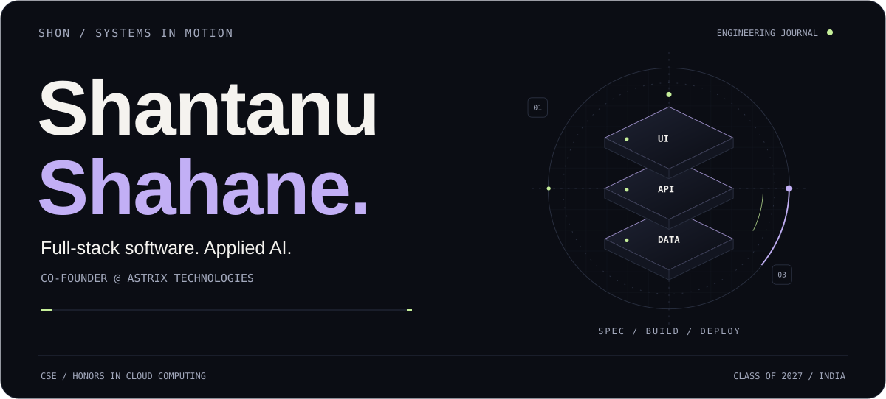
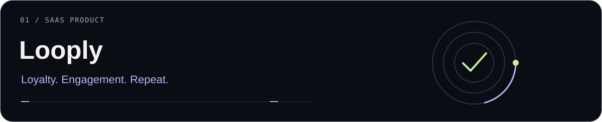
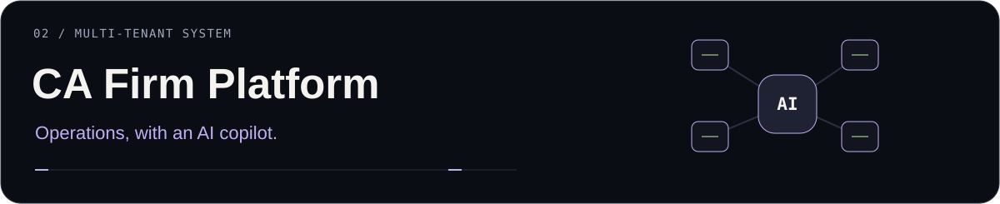

<!-- Systems in Motion / Shantanu Shahane. Upload assets/ beside README.md. -->
<picture>
  <source media="(max-width: 600px) and (prefers-color-scheme: light)" srcset="./assets/motion/hero-mobile-light.svg">
  <source media="(max-width: 600px)" srcset="./assets/motion/hero-mobile-dark.svg">
  <source media="(prefers-color-scheme: light)" srcset="./assets/motion/hero-light.svg">
  
</picture>

<b>Shantanu Rameshwar Shahane</b> Co-Founder &amp; Software Engineer at Astrix Technologies Final-year Computer Science Engineering · Honors in Cloud Computing

  <a href="https://www.shantanushahane.in/"><picture><source media="(prefers-color-scheme: light)" srcset="./assets/motion/portfolio-light.svg"></picture></a>
  <a href="https://looply.codexajinkya.in/"><picture><source media="(prefers-color-scheme: light)" srcset="./assets/motion/looply-link-light.svg"></picture></a>
  <a href="./assets/resume/Shantanu_Shahane_Resume.pdf"><picture><source media="(prefers-color-scheme: light)" srcset="./assets/motion/resume-light.svg"></picture></a>
  <a href="https://www.linkedin.com/in/shantanu-shahane-ashtekar-4954251b8/"><picture><source media="(prefers-color-scheme: light)" srcset="./assets/motion/linkedin-light.svg"></picture></a>
  <a href="mailto:shantanushahane2505@gmail.com"><picture><source media="(prefers-color-scheme: light)" srcset="./assets/motion/email-light.svg"></picture></a>

I build **full-stack SaaS products, AI-powered features, and workflow automations**. At **Astrix Technologies**, I work across product design, frontend, backend, databases, integrations, and deployment.

My current toolkit centers on **TypeScript, React / Next.js, Node.js, PostgreSQL, Python, and AWS**. I use Claude Code and Codex alongside written specs, code review, and hands-on engineering.

## 01 / Selected builds

<!-- All project covers are original conceptual illustrations, not screenshots or live metrics. -->

### Looply — customer loyalty & engagement

<a href="https://looply.codexajinkya.in/"><picture>
  <source media="(prefers-color-scheme: light)" srcset="./assets/motion/looply-light.svg">
  
</picture></a>

A platform for businesses to manage **rewards, visits, transactions, and engagement campaigns**. I built the REST APIs, database schema, and role-based access for business owners and staff.

`TypeScript` `Next.js` `Node.js` `PostgreSQL` `AWS`

**[Open Looply ↗](https://looply.codexajinkya.in/)**

### CA Firm Automation — multi-tenant CRM

<picture>
  <source media="(prefers-color-scheme: light)" srcset="./assets/motion/ca-platform-light.svg">
  
</picture>

A CRM for managing **clients, compliance deadlines, tasks, and billing** across organizations, with tenant isolation and role-based access. Its **Groq-powered compliance copilot** answers questions using live CRM data; **n8n workflows** automate recurring operations.

`TypeScript` `React` `Node.js` `PostgreSQL` `Prisma` `Groq` `n8n`

**[Ask me about this project ↗](mailto:shantanushahane2505@gmail.com?subject=CA%20Firm%20Automation%20Platform)**

<!-- Add a public case study or repository link when one is available. -->

### StockSense — financial news sentiment

<a href="https://github.com/shon2505/StockSense"><picture>
  <source media="(prefers-color-scheme: light)" srcset="./assets/motion/stocksense-light.svg">
  
</picture></a>

A platform that analyzes **financial news sentiment with a trained ML model** to estimate stock trends, with TradingView charts for market context.

`Python` `TypeScript` `Machine learning` `TradingView`

**[Explore the repository ↗](https://github.com/shon2505/StockSense)**

<b>More builds / AI, cloud &amp; earlier projects</b>

| Project | What it explores | Links |
| :--- | :--- | :--- |
| **CloudMentor** | A cloud-computing study assistant with streaming AI responses; Next.js, TypeScript, and Groq. | [Code](https://github.com/shon2505/Cloud_Mentor) · [Demo](https://cloud-mentor-ochre.vercel.app) |
| **SahmatiPay** | AI financial agreement analysis; hackathon-winning project. | [Code](https://github.com/shon2505/SahmatiPay) · [Demo](https://sahmati-pay.vercel.app) |
| **Aegis Healthcare** | An earlier healthcare software project. | [Code](https://github.com/shon2505/AEGIS_HealthCare) |
| **Face Recognition Attendance System** | 1st prize in the Polytechnic Final Year Project Competition. | [Discuss the project](mailto:shantanushahane2505@gmail.com?subject=Face%20Recognition%20Attendance%20System) |

[Browse all repositories →](https://github.com/shon2505?tab=repositories)

## 02 / Engineering toolkit

| Layer | Technologies |
| :--- | :--- |
| **Interface** | TypeScript · JavaScript · React · Next.js |
| **Backend & data** | Node.js · Express · PostgreSQL · Prisma · MongoDB · REST APIs · SQL |
| **AI & automation** | Python · Groq / LLM APIs · n8n · AI agents · Claude Code · Codex · ChatGPT |
| **Cloud & delivery** | AWS · Docker · Vercel · Linux / CLI · Git · GitHub · Postman |
| **Foundations** | Java · C · C++ · DSA · OOP · Agile / Scrum · TCP/IP · HTTP / HTTPS |

<b>Earlier experience &amp; additional tools</b>

Advanced Java · JSP · Android development · Android Studio · MySQL · HTML · CSS · Bootstrap · PHP · .NET · Regular expressions

My earlier cloud-learning interests also include Microsoft Azure.

## 03 / Experience

| Role | Work |
| :--- | :--- |
| **Co-Founder & Software Engineer · Astrix Technologies** Current | End-to-end SaaS and client web development, API integrations, databases, deployment, and AI automation. Client work includes Energy Star Homes, Grand Renovations, and The Lotus Roots. |
| **Full Stack Developer Intern · EatZze** Feb–Mar 2025 | MERN development, backend REST APIs, database operations, responsive interfaces, and application performance work. |
| **Software Developer Intern · NasKraft IT Solutions** Jun–Sep 2023 | Android development, JSP backend logic, and database connectivity. |

## 04 / Milestones

- **Hackathon winner** — SahmatiPay, an AI financial agreement analyzer.
- **1st prize** — Face Recognition Attendance System, Polytechnic Final Year Project Competition.
- **B.Tech Computer Science Engineering, Honors in Cloud Computing** — Maharashtra Institute of Technology, Chhatrapati Sambhajinagar. Expected graduation: **May 2027**.

<b>Certifications &amp; education</b>

- AWS Cloud Quest: Cloud Practitioner — AWS Skill Builder.
- Oracle Generative AI Certification.
- Diploma in Computer Engineering — MIT Polytechnic, **90%**.
- SSC — Saint Xavier’s High School, **85%**.

## 05 / GitHub activity

<b>Contributions, languages &amp; activity patterns</b>

  
  

  
  

Repository activity and language statistics; not proficiency ratings.

<b>Contributions</b>

<picture>
  <source media="(prefers-color-scheme: dark)" srcset="./assets/github-snake-dark.svg">
  <source media="(prefers-color-scheme: light)" srcset="./assets/github-snake.svg">
  
</picture>

<b>Profile visits</b>

---

<picture>
  <source media="(prefers-color-scheme: light)" srcset="./assets/motion/footer-light.svg">
  
</picture>

**[Portfolio](https://www.shantanushahane.in/) · [Latest résumé](./assets/resume/Shantanu_Shahane_Resume.pdf) · [LinkedIn](https://www.linkedin.com/in/shantanu-shahane-ashtekar-4954251b8/) · [Email](mailto:shantanushahane2505@gmail.com)**

Based in Chhatrapati Sambhajinagar, Maharashtra, India.

